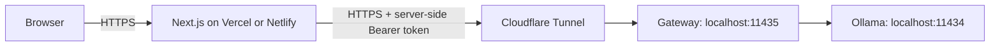

# Vercel / Netlify backend setup

The website runs on Vercel or Netlify. An authenticated Node.js gateway runs on your PC and calls Ollama. Cloudflare Tunnel gives the gateway an HTTPS address.



The secret stays in server-side environment settings. The gateway exposes inference only, not model installation, deletion, or other Ollama management APIs.

## Start the backend

Requirements: Node.js 24, Ollama running, Qwen downloaded, and `tools/cloudflared.exe` available.

```powershell
cd D:\Food_Scan
ollama pull qwen3.5:4b
powershell -ExecutionPolicy Bypass -File scripts/start-backend.ps1
```

On first use the script generates `.env.gateway.local` with a random secret. Existing settings are preserved. It starts the gateway on localhost port 11435 and prints a temporary HTTPS tunnel URL.

Keep the terminal open and the PC awake and online. Ctrl+C stops the tunnel and the gateway started by this script. Ollama remains a separate application. If the development gateway is already running, do not start a second one on the same port.

## Export hosting settings

Use the backend URL printed by Cloudflare in another terminal:

```powershell
node --env-file=.env.gateway.local scripts/export-hosting-env.mjs https://YOUR-BACKEND.trycloudflare.com
```

This writes the private, Git-ignored `.env.hosting.local` file:

| Variable | Value |
| --- | --- |
| `OLLAMA_GATEWAY_URL` | Backend HTTPS root URL, without `/api/chat` |
| `OLLAMA_GATEWAY_TOKEN` | Secret copied from `.env.gateway.local` |
| `OLLAMA_MODEL` | `qwen3.5:4b` |
| `OLLAMA_TIMEOUT_MS` | `55000` |

Copy these values into the hosting dashboard's server-side environment settings. Never use `NEXT_PUBLIC_` prefixes or commit either private env file. Hugging Face and Gemini keys are unnecessary.

Use the **backend tunnel**, not the earlier website demo tunnel on port 3000. The gateway ultimately controls which model runs.

## Vercel

1. Import `Gorilla1216/Plate-recognize`, branch `master`, including the backend-support changes.
2. Choose Next.js and the repository root; keep the default build/output settings (`npm run build`).
3. Add the four variables above to Production and, if desired, Preview.
4. Deploy. Redeploy after changing environment settings.
5. Test photo analysis, ingredients, and chat on the deployed URL.

The AI routes request a 60-second function duration; platform settings and plan limits still apply. Vercel limits function payloads to 4.5 MB, including multipart overhead, so keep photos smaller if requests return 413 before reaching the app.

References: [Next.js on Vercel](https://vercel.com/docs/frameworks/full-stack/nextjs), [environment variables](https://vercel.com/docs/environment-variables), [function limits](https://vercel.com/docs/functions/limitations).

## Netlify

1. Import the same repository and `master` branch.
2. Let Netlify detect Next.js and use its automatic adapter.
3. Set build command `npm run build` and publish directory `.next`.
4. Add the four variables with runtime/function access in the desired deployment contexts.
5. Deploy and test all three AI features.

Netlify synchronous functions have a 60-second limit. The hosted adapter times out after 55 seconds; the gateway times out after 50 seconds, leaving time to return an error. A slow cold start can still time out. Warming the model locally before a demo can help.

References: [Next.js on Netlify](https://docs.netlify.com/build/frameworks/framework-setup-guides/nextjs/overview/), [function configuration](https://docs.netlify.com/build/functions/configuration/).

## Verification

```powershell
node --env-file=.env.hosting.local scripts/check-backend.mjs
npm.cmd run test:backend
```

The live check verifies unauthenticated rejection, authenticated text inference, and sample-photo inference through the hosted adapter. It does not print the secret. Public `GET /health` confirms only that the gateway process responds, not model readiness.

## Controls and limitations

- Gateway binds to localhost. Tunnel port **11435**, not raw Ollama port 11434.
- Authentication is checked before inference using fixed-length hashes and a timing-safe comparison.
- Only `POST /api/chat` performs inference; the caller cannot choose another upstream path or model.
- Limits: 6 MiB request body, one image up to 4 MiB, 13 messages, 1600 output tokens, 4096-token context.
- One inference runs at a time; concurrent requests receive 429.
- Hosted adapter sends its secret only to the configured HTTPS gateway and refuses redirects.
- This authenticates the website server, not visitors. The public website still has no visitor login or per-user rate limiting.
- Quick Tunnel hostnames change on restart. Update `OLLAMA_GATEWAY_URL` and redeploy each time. A named tunnel and domain can provide a stable hostname later.
- To rotate the token, replace it in `.env.gateway.local` with a new random value of at least 32 characters, restart the gateway, update hosting settings, and redeploy.

| Error | Action |
| --- | --- |
| 401 | Ensure the hosting token matches the gateway token |
| 429 | Wait for the running inference to finish |
| 503 | Check PC, tunnel, gateway, Ollama, model, and env configuration |
| 504 / platform timeout | Try a smaller image or warm the model |
| 413 | Reduce upload size; both host and gateway limits apply |
| HTML / unexpected JSON | Check that the URL points to the backend, not the old website tunnel |

Manual launch without a tunnel: `node scripts/setup-backend.mjs`, then `npm.cmd run backend`. The combined launcher writes gateway logs under ignored `logs/`.
