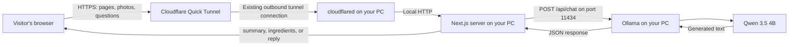

# How Food Scan Works

Food Scan is a Next.js application that sends food photos and questions to an AI model running on your own PC through Ollama. The frontend is based on the reference repository, while the active AI routes use local inference instead of Hugging Face or Gemini.

The interface remains in Mongolian. AI answers use English because the small local models tested produced unreliable Mongolian answers.

## 1. Architecture



When using `http://localhost:3000`, the browser connects directly to Next.js and skips Cloudflare. Public visitors use the tunnel URL, but the AI processing still happens on your PC.

| Component | Responsibility | Main source |
| --- | --- | --- |
| React frontend | Tabs, uploads, previews, chat, theme switching | `app/components/` |
| Next.js API routes | Validate input, construct prompts, return results | `app/api/` |
| Ollama adapter | Convert messages and call the local model service | `app/lib/ollama.ts` |
| Ollama | Load model weights and execute inference | Separate installed application |
| Qwen 3.5 4B | Interpret images and generate text | Downloaded Ollama model |
| Cloudflare Tunnel | Forward public HTTPS requests to the local web server | `tools/cloudflared.exe` |

## 2. Frontend behavior

`app/page.tsx` renders `AppShell`, which selects between image analysis, ingredient recognition, and image creation. React state stores the selected tab and each component's current input, loading state, result, and error.

For photo uploads, the browser creates an object URL to show a preview. That preview is separate from the actual upload: the API receives the original file using `FormData` and `multipart/form-data`. The analysis component also accepts drag-and-drop and pasted images.

The floating chat sends its conversation as JSON. Messages live in React state rather than a database. Refreshing the page resets that conversation. Theme preference is stored in browser local storage.

The frontend calls relative URLs such as `/api/analyze`. Consequently, the same code works through localhost or the public tunnel without embedding your PC's address in the browser.

## 3. Photo analysis, step by step

The request path is implemented in `app/api/analyze/route.ts`:

1. The browser sends the photo as the `image` form field to `POST /api/analyze`.
2. The route requires a file with MIME type `image/jpeg` or `image/png`, no larger than 4 MiB.
3. The server reads the bytes into memory and converts them to a base64 data URL.
4. It combines the photo with a prompt asking for visible ingredients and a short English description. The prompt asks the model to mark uncertainty rather than guess hidden ingredients.
5. `ollamaChat()` extracts the base64 image bytes and sends the prompt and image to Ollama.
6. Ollama runs the vision-language model and returns generated text.
7. Next.js returns `{ "summary": "..." }`, which the frontend displays.

Base64 is a transport encoding, not image recognition or encryption. The model performs recognition after receiving the image. These routes do not resize the image before sending it to Ollama.

## 4. Ingredient recognition

`POST /api/ingredients` accepts an optional `note` and an optional `image`. At least one must be present. Images use the same type and size checks as photo analysis.

The route uses one model request:

- With a photo, it asks for ingredients visibly identifiable in that photo.
- With text alone, it asks for the usual ingredients of the described dish.

The adapter enables Ollama's JSON output mode with `format: "json"`. The prompt requests this structure:

```json
{
  "ingredients": ["penne pasta", "tomato sauce", "ground meat"]
}
```

The route parses the generated JSON, checks that `ingredients` is an array, keeps nonempty strings, and returns that array. JSON mode helps with output formatting; it does not guarantee that an ingredient is factually correct.

## 5. Chat

`POST /api/chat` accepts a JSON object containing a `messages` array. It keeps messages with valid `user` or `assistant` roles and nonempty text.

The server prepends a cooking-assistant system instruction and forwards the last 12 valid messages. That gives the model recent conversation context while limiting the amount of history sent on each request. The response is returned as `{ "reply": "..." }`.

There is no model training or permanent memory involved. Each request supplies the conversation context the model needs for that response.

## 6. The Ollama connection

The adapter uses these defaults, which can be overridden in `.env.local`:

```env
OLLAMA_BASE_URL=http://127.0.0.1:11434
OLLAMA_MODEL=qwen3.5:4b
```

These are server-side settings. The visitor's browser does not connect directly to Ollama.

A simplified request from Next.js to Ollama looks like this:

```json
{
  "model": "qwen3.5:4b",
  "stream": false,
  "think": false,
  "messages": [
    {
      "role": "user",
      "content": "Describe this food in English.",
      "images": ["BASE64_IMAGE_BYTES"]
    }
  ],
  "options": {
    "num_predict": 1600,
    "num_ctx": 4096,
    "temperature": 0.2
  }
}
```

| Setting | Current behavior |
| --- | --- |
| `stream: false` | Wait for the complete answer before returning it to the UI |
| `think: false` | Disable thinking output for models whose names start with `qwen` |
| `num_predict` | Maximum output tokens: 1600 for analysis; 800 for ingredients and chat |
| `num_ctx: 4096` | Request a 4096-token context window |
| `temperature: 0.2` | Favor more consistent generation; answers can still vary |
| `format: "json"` | Enabled for ingredient recognition |
| Request timeout | Abort the Ollama fetch after 300 seconds |

Ollama loads the downloaded model into available GPU and system memory. The setup detected an NVIDIA RTX 3050 Laptop GPU with 4 GiB of VRAM. Actual inference speed depends on available memory, GPU offloading, image size, and output length. A first request can take longer while the model loads.

## 7. How the public demo works

The current demo was started with a production Next.js server on `127.0.0.1:3000`, followed by:

```powershell
.\tools\cloudflared.exe tunnel --url http://127.0.0.1:3000 --no-autoupdate
```

`cloudflared` establishes an outbound connection to Cloudflare and receives a temporary `trycloudflare.com` hostname. Cloudflare forwards visitors' requests over that connection to the web server. No router port forwarding was configured.

Ollama remains on `127.0.0.1:11434`; the tunnel points to Next.js, not the Ollama API. Public visitors can use the AI through the application's API routes.

For future launches, `scripts/start-demo.ps1` automates the process:

1. Check that the tunnel executable exists and Ollama responds.
2. Build the Next.js app.
3. Start a production web server on **port 3001**.
4. Wait for the page to respond.
5. Run the tunnel and print its public URL.
6. Stop the script-owned web server when the script exits.

The script's port 3001 is intentional; the manually started current demo uses port 3000. The script expects Ollama and the selected model to be installed already.

```powershell
powershell -ExecutionPolicy Bypass -File scripts/start-demo.ps1
```

This is a temporary demo hosted by your PC. The machine must remain awake, online, and running Ollama, Next.js, and the tunnel. The public hostname changes when a new Quick Tunnel is created. A tunnel's request timeout can be shorter than the adapter's five-minute local timeout.

## 8. Data, cost, and current limitations

- **No active cloud AI calls:** Analysis, ingredients, and chat use Ollama. Existing Hugging Face or Gemini keys are not used by these routes. The legacy `app/lib/hf.ts` file still supplies their shared `errorResponse()` helper; its filename does not mean these routes call Hugging Face.
- **Local inference:** The app does not intentionally save uploaded photos to disk or store conversations in a database. Images are read into memory for the model request. This is not a guarantee about all underlying service logs or caches.
- **Public traffic crosses Cloudflare:** Remote uploads and questions pass through Cloudflare before reaching your PC. Public-demo traffic is therefore not an entirely local data path.
- **No API usage fees:** The local model uses your hardware and electricity. Downloading and serving it also uses disk space and bandwidth.
- **Demo access:** The application currently has no login or application-level rate limiting. Anyone with the demo URL can submit requests, sharing the same PC's inference capacity.
- **Image generation:** `POST /api/generate` deliberately returns 503 with an explanation. The configured model interprets images and produces text; it does not create images. A separate local image-generation backend would be needed.
- **Accuracy:** Food recognition is a model prediction, not a verified recipe or an allergen check. English was selected after observed Mongolian-quality problems with the small models.

## 9. Errors and verification

| Status | Typical cause |
| --- | --- |
| 400 | Missing input, unsupported image type, oversized image, or invalid chat input |
| 502 | Empty model response or unusable ingredient output |
| 503 | Ollama is unavailable, the model is missing, an Ollama request fails, or image generation is requested |
| 504 | The request to Ollama exceeds its timeout |

Routes return errors as `{ "error": "..." }`, and the frontend displays that message. Some unexpected exceptions still use the shared helper's default 500 status.

The implementation was checked with a production build, TypeScript, adapter tests, live photo analysis, text and photo ingredient requests, and a chat request through the public tunnel. These checks verify the connection and response handling, not general model accuracy.

```powershell
node --test scripts/test-ollama.mjs
npx.cmd tsc --noEmit
npm.cmd run build
```

For installation and startup instructions, see [SETUP.md](SETUP.md).
